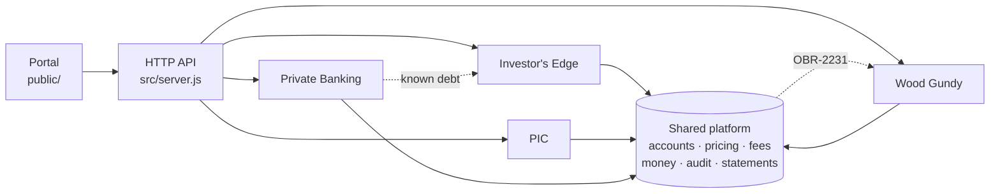

# OBR: Online Brokerage & Reporting

[](https://github.com/factory-senura-jayatunge/cibc-test78569/actions/workflows/ci.yml)
[](https://github.com/factory-senura-jayatunge/cibc-test78569/actions/workflows/nightly-regression.yml)


> [!IMPORTANT]
> **Synthetic demo data.** This repository is a model of a wealth-management platform, built for a Factory demo. Every account, client name, balance, price, and fee schedule is fictional. It contains no CIBC code, systems, or client data, and it is not affiliated with or endorsed by CIBC.

OBR is the wealth platform behind four lines of business. They share one codebase, one regression catalogue, and one release train. A shared platform core provides accounts, pricing, fees, audit, and quarterly statements. Each line of business owns its own module on top of that core.

| Line of business | Module | What it does |
| --- | --- | --- |
| Investor's Edge | `src/lob/investors-edge/` | Self-directed brokerage: order preview, commissions, trading activity |
| Wood Gundy | `src/lob/wood-gundy/` | Full-service, fee-based advisory: tiered advisory fees, advisory relationship reporting |
| PIC | `src/lob/pic/` | Discretionary portfolio management: mandates, allocation drift, rebalance signals |
| Private Banking | `src/lob/private-banking/` | Secured lines of credit: limits, collateral, loan-to-value |

## Getting started

You need Node 22 or later. The application has one runtime dependency (lodash, used by the Wood Gundy fee disclosure letters since 2026.10), so install first:

```bash
npm ci       # runtime dependency, dev tooling for the quality gates, plus the pre-commit hook
npm test     # unit and API tests
npm start    # portal and API at http://localhost:3000
npm run check
```

Set `PORT` to change the port and `LOG_LEVEL` to change the log level. Set `AUDIT_STDOUT=1` to echo audit events to the console. `.env.example` lists every variable. A dev container is in `.devcontainer/`.

## Commands

| Command | What it does |
| --- | --- |
| `npm test` | Runs all unit and API tests with `node:test` |
| `npm start` | Starts the HTTP API and the statement portal. Logs one JSON line per request |
| `npm run check` | Runs every quality gate: lint, format, types, dead code, duplication, docs drift, file size, and coverage thresholds |
| `npm run test:coverage` | Runs the tests with coverage thresholds |
| `npm run profile` | CPU-profiles the API under a short load and prints the hottest functions |
| `npm run impact` | Change-impact analysis against the release baseline. Writes `out/impact.json` and `out/impact-report.md` |
| `npm run impact -- --files a,b` | Predicts the regression scope of files you plan to change. Writes `out/impact-prediction.json` |
| `npm run impact -- --base <ref>` | Change-impact analysis against a Git ref, as CI does for pull requests |
| `npm run regression:scoped` | Runs only the suites the last impact analysis selected |
| `npm run regression:full` | Runs the whole catalogue (18 hours in production terms) |
| `npm run coupling` | Reports cross-boundary imports and ranks lines of business for extraction. Writes `out/coupling-report.md` |
| `npm run release:pack` | Builds `out/release-pack.html`, a release-readiness page, from the evidence in `out/` |
| `npm run baseline` | Records the current tree as the release baseline. Release managers run it at a release cut |

## Architecture



Lines of business depend on the platform. They must not depend on each other, and the platform must not depend on them. Two dotted edges break that rule today and are tracked as debt. They matter because a change to code on the far end of either edge widens regression scope. See [docs/architecture.md](docs/architecture.md).

## API

| Method | Path | Returns |
| --- | --- | --- |
| `GET` | `/api/health` | Liveness check |
| `GET` | `/api/metrics` | Prometheus metrics: request counts and latency by route |
| `GET` | `/api/accounts?lob=<lob>` | Account summaries, optionally filtered by line of business |
| `GET` | `/api/statements/:accountId?quarter=YYYY-Qn` | Quarterly statement for any account |
| `POST` | `/api/orders/preview` | Investor's Edge order preview with commission and net amount |
| `GET` | `/api/credit/:accountId` | Private Banking credit facility summary |
| `POST` | `/api/advisory/:accountId/fee-disclosure` | Wood Gundy advisory fee disclosure letter, from a catalogued template or a draft |
| `GET` | `/api/mandates/:accountId/drift` | PIC mandate allocation drift |

Request and response examples are in [docs/api.md](docs/api.md). The OpenAPI schema is [docs/openapi.yaml](docs/openapi.yaml). Every response carries an `X-Request-ID` header that matches the `requestId` in the logs.

## How changes ship

Every change starts as a change request with numbered acceptance criteria. It moves through a fixed path:

1. **Predict.** `npm run impact -- --files <planned files>` shows which suites the change will pull in, and why, before anyone writes code.
2. **Build inside the boundary.** The change stays in its own `src/lob/<lob>/` folder. Each acceptance criterion gets a test whose name starts with its ID.
3. **Prove.** `npm test`, then `npm run impact`, then `npm run regression:scoped`.
4. **File evidence.** The release note maps criteria to tests and records the regression scope, risks, and rollback.
5. **Approve.** A person reviews and merges. Full regression still runs nightly and before every release cut.

Most changes run a fraction of the 18-hour catalogue. For example, the 2026.11 release train needs 4 of 15 suites, which is 5 hours. See [docs/release-process.md](docs/release-process.md) and [docs/regression.md](docs/regression.md).

## Repository layout

```text
src/platform/          Shared core: accounts, pricing, fees, money, audit, statements
src/lob/<lob>/         One folder per line of business; index.js is its public surface
src/server.js          HTTP API (route table) and static portal
src/observability/     Structured logger, Prometheus metrics, request IDs
public/                Statement portal (vanilla JS, no build)
tests/                 One file per regression suite
regression/catalog.json  Suite ownership, covered files, production-equivalent minutes
scripts/               Impact analysis, scoped regression, coupling report, release pack, profiler, docs checks
.baseline/             Release baseline: file manifest and snapshot of the last release
security/findings/     Archived scanner findings (SARIF plus a human-readable note per scan)
.factory/              Droids, commands, and skills for agent-assisted delivery
docs/                  Architecture, lines of business, API, release process, regression
```

## Continuous integration

| Workflow | Trigger | What it runs |
| --- | --- | --- |
| [CI](.github/workflows/ci.yml) | Every pull request and push to `main` | The quality gates (`npm run check` steps), `npm test`, and the coupling report. Pull requests also run impact analysis against the target branch and the scoped regression, and post the impact report to the job summary |
| [Nightly regression](.github/workflows/nightly-regression.yml) | Daily at 06:00 UTC, or on demand | `npm run regression:full -- --retries 1`. Flaky suites are reported. A scheduled failure opens or updates a **Nightly regression failed** issue |
| [CodeQL](.github/workflows/codeql.yml) | Pull requests, pushes to `main`, weekly | Static security analysis (`security-extended` queries) |
| [Security scan](.github/workflows/security-scan.yml) | Pull requests, pushes to `main`, weekly, or on demand | `npm audit` converted to SARIF and uploaded to code scanning. Findings are archived under `security/findings/` |
| [DAST](.github/workflows/dast.yml) | Pull requests, weekly, or on demand | OWASP ZAP baseline scan against the running API and portal |
| [Droid Auto Review](.github/workflows/droid-review.yml) | Pull requests opened or marked ready | Automated code and security review comments. Needs the `FACTORY_API_KEY` secret |
| [Dependabot](.github/dependabot.yml) | Weekly | Dev tooling and GitHub Actions updates, held for 7 days after release |

## Documentation

- [Architecture](docs/architecture.md)
- [Lines of business](docs/lines-of-business.md)
- [API reference](docs/api.md)
- [Release process](docs/release-process.md)
- [Regression and impact analysis](docs/regression.md)
- [Runbooks](docs/runbooks/README.md) and the [OpenAPI schema](docs/openapi.yaml)
- [Change requests](docs/change-requests/) and [release notes](docs/releases/)
- [Contributing](CONTRIBUTING.md), [security](SECURITY.md), and the [changelog](CHANGELOG.md)

## About this repository

This is a synthetic model built for a Factory point-of-view demo, from discovery notes with Olaf Vogel (Investor's Edge). It contains no CIBC code, systems, or client data. The production-equivalent minutes in `regression/catalog.json` are illustrative. They are sized so the full catalogue equals the 18-hour regression cycle described in discovery.
