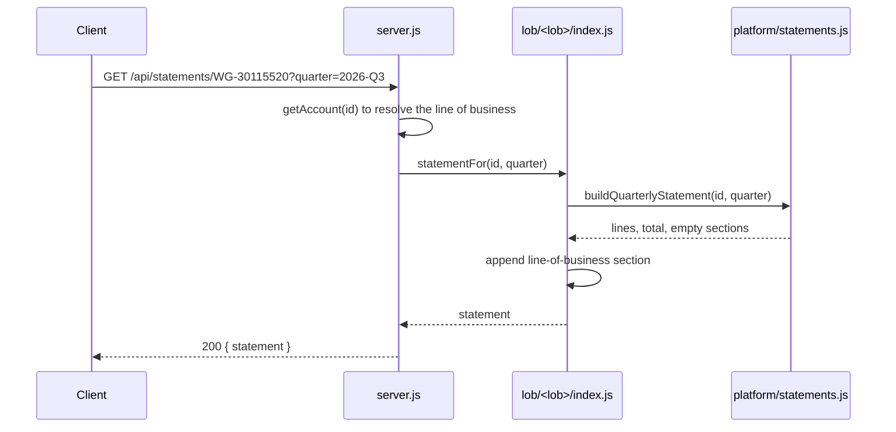

# Architecture

OBR is a modular monolith. One Node process serves the HTTP API and the statement portal. The code splits into a shared platform core and one module per line of business. All four lines of business ship together on one release train.

## Components

| Component | Path | Responsibility |
| --- | --- | --- |
| HTTP API and portal | `src/server.js` | Routes `/api/*` requests to line-of-business modules, serves `public/`, and maps errors to status codes |
| Accounts | `src/platform/accounts.js` | The client account book. `listAccounts(lob)` and `getAccount(id)` return copies, so callers cannot mutate shared state |
| Pricing | `src/platform/pricing.js` | Prices and asset classes for listed symbols, and `marketValue(positions)` |
| Fees | `src/platform/fees.js` | Fee schedules for every line of business, `tieredAnnualFee`, and `commissionFor` |
| Money | `src/platform/money.js` | `roundCents` and `roundRatio`. All money and ratio rounding goes through these two functions |
| Audit | `src/platform/audit.js` | In-memory audit log. `AUDIT_STDOUT=1` echoes each event to stdout |
| Statements | `src/platform/statements.js` | `buildQuarterlyStatement`: cash, holdings at market value, and the total. Line-of-business modules add their own sections |
| Line-of-business modules | `src/lob/<lob>/` | Business rules for one line of business. `index.js` is the public surface the API calls |

## Request flow

A statement request shows how the layers fit together:

Every line of business exports `statementFor(accountId, quarter)`. The server looks up the account's line of business and calls that module, so adding a statement section never touches the server.

## Dependency rules

1. Lines of business may import from `src/platform/`.
2. Lines of business must not import from each other.
3. The platform must not import from any line of business.

The rules exist because the regression scope follows the import graph. A file is only as isolated as the set of files that import it. `npm run coupling` checks the rules and lists every violation.

### Known debt

Two imports break the rules today:

| Import | Kind | Effect | Tracking |
| --- | --- | --- | --- |
| `src/platform/statements.js` imports `src/lob/wood-gundy/advisory.js` | Platform depends on a line of business | A change to Wood Gundy fee code reaches the shared statement builder, so all four lines of business' statement suites run | OBR-2231: move the advisory fee line behind a per-line-of-business hook |
| `src/lob/private-banking/credit.js` imports `src/lob/investors-edge/trading.js` | Line of business depends on another | A change to Investor's Edge trading pulls Private Banking credit into scope. Private Banking cannot be extracted without Investor's Edge | Expose collateral valuation through a platform contract |

Until OBR-2231 is fixed, Wood Gundy changes go in `src/lob/wood-gundy/index.js` where possible, not in `advisory.js`. For WG-1042, that choice kept regression at 2 suites (2.0 h) instead of 6 suites (7.5 h).

## Extraction readiness

`npm run coupling` ranks lines of business by how cleanly each could become a separate service:

| Rank | Line of business | Blocking couplings | Platform contracts needed |
| --- | --- | --- | --- |
| 1 | PIC | 0 | 4 |
| 2 | Private Banking | 1 | 4 |
| 3 | Wood Gundy | 1 | 5 |
| 4 | Investor's Edge | 1 | 6 |

PIC has no blocking couplings, so it is the first candidate for a strangler-fig extraction. The `/extract-plan` command drafts that plan from the live coupling report. See [release-process.md](release-process.md#agent-assisted-delivery).

## Errors

| Condition | Status |
| --- | --- |
| Unknown account or symbol (`error.code === 'NOT_FOUND'`) | 404 |
| Invalid order (`INVALID_ORDER`), invalid quarter or wrong account type (`RangeError`), malformed JSON (`SyntaxError`) | 400 |
| Anything else | 500, with a generic message so internals do not leak |

## Data

All data is synthetic and held in memory. There is no database. Accounts live in `src/platform/accounts.js`, and prices in `src/platform/pricing.js`. The three listed instruments are fictional Northshore index funds.
