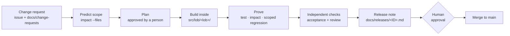

# Release process

OBR ships on one release train for all four lines of business. A release is only as safe as the evidence behind it, so each step leaves an artifact that a reviewer can check.

## Release baseline

`.baseline/` records the last release. `manifest.json` holds a SHA-256 hash of every file under `src/`, `tests/`, `public/`, and `regression/`. `snapshot/` holds a copy of those files. Impact analysis compares the working tree with the manifest, and rollback restores files from the snapshot.

Only a release manager changes the baseline. They run `npm run baseline` at a release cut, after full regression passes. Pull requests must not edit `.baseline/`.

## Lifecycle of a change



### 1. Intake

A change request is a GitHub issue opened from the **Change request** template. Its body is mirrored to `docs/change-requests/<ID>-<slug>.md`. It names the line of business, the requester, the target release, and numbered acceptance criteria (`AC1`, `AC2`, and so on).

### 2. Predict the blast radius

Before writing code, list the files you expect to change and run:

```bash
npm run impact -- --files src/lob/wood-gundy/index.js,tests/wg-statements.test.js
```

The prediction is written to `out/impact-prediction.json`, so it never overwrites the report that scoped regression reads. If a shared-platform file or a known coupling widens the scope, look for a design that stays inside the line-of-business boundary. WG-1042 is the reference case: editing `advisory.js` would have pulled in 6 suites (7.5 h), and building the change in `index.js` kept it to 2 suites (2.0 h).

### 3. Build

- Keep the change inside `src/lob/<lob>/`. A platform change must be called out and justified in the plan.
- Add no new imports between lines of business, or from the platform into a line of business.
- Round money with `roundCents` and ratios with `roundRatio`.
- Never write unmasked account numbers or client names to logs or audit detail.
- Name each acceptance test after its criterion, for example `WG-1042 AC1: ...`.
- Register any new test file in `regression/catalog.json`.

### 4. Prove

```bash
npm test
npm run impact
npm run regression:scoped
```

All three must pass. CI runs the same steps on every pull request, with `--base origin/main` in place of the release baseline.

### 5. Independent checks

Two reviewers that did not write the change check it. Both are defined as droids in `.factory/droids/`:

- **acceptance-verifier** maps every acceptance criterion to its code and to a test, and confirms the test would fail without the change.
- **release-reviewer** reviews correctness, security, and repository rules. It reports each finding as new in this release or pre-existing.

A gap or a high or medium finding in changed code sends the change back to step 3.

### 6. Release note

Each change request gets a release note, written to `out/release-note-<ID>.md` and filed as `docs/releases/<ID>.md` in the same pull request. It contains:

1. A summary of the change.
2. A table that maps each acceptance criterion to its test.
3. The impact report.
4. The scoped regression result.
5. Risks, including pre-existing issues the change did not touch.
6. Rollback steps.

`npm run release:pack` combines every release note with the impact and regression evidence into `out/release-pack.html`, a single page for the release manager.

### 7. Approval and merge

A person approves every change. Agents never merge, push to `main`, or deploy. Code owners in `.github/CODEOWNERS` must approve changes in their area.

## Release cut

1. Merge the approved changes for the train.
2. Run `npm run regression:full`. The nightly workflow also runs it every day.
3. Build the release pack and attach it to the release.
4. Record the new baseline with `npm run baseline`.
5. Move the `[Unreleased]` entries in `CHANGELOG.md` under the release version.

## Rollback

Every release note lists the files to restore. Two options:

- Revert the merge commit on `main`.
- Restore the listed files from `.baseline/snapshot/`.

No change in this repository involves data, schema, or configuration migrations, so a rollback is code only.

## Agent-assisted delivery

`.factory/commands/` defines slash commands that run this process with Factory droids. Each one stops before anything is committed.

| Command | What it does |
| --- | --- |
| `/deliver <ID>` | Steps 1 to 6 for one change request. Pauses for approval of the plan before any edit |
| `/release-train <IDs>` | Delivers several change requests in parallel, runs independent checks, builds the release pack, and stops at a human approval gate |
| `/release-check` | Go or no-go summary for the current working tree, built only from repository evidence |
| `/impact` | Explains the current regression scope in plain language for QA and release owners |
| `/extract-plan <lob>` | Drafts a strangler-fig plan to extract one line of business, grounded in the coupling report |

`AGENTS.md` holds the rules every agent follows.
